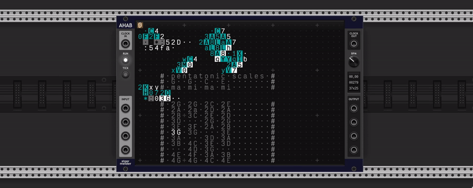
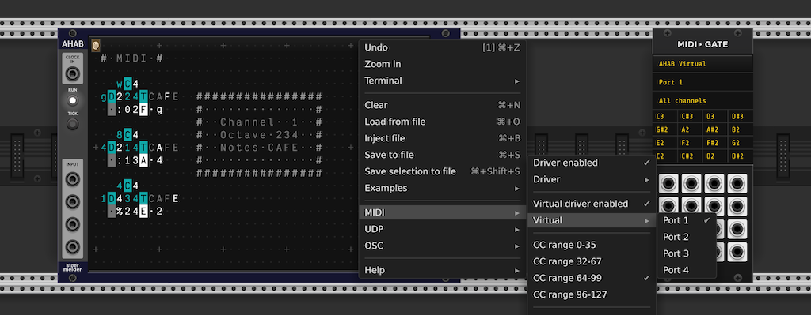
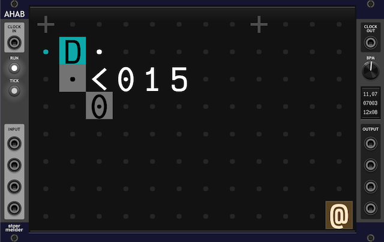
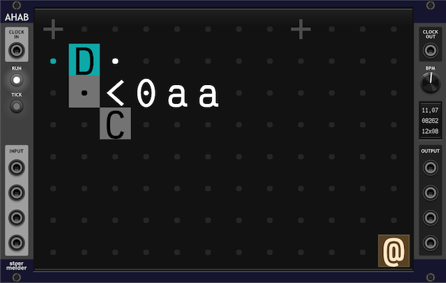
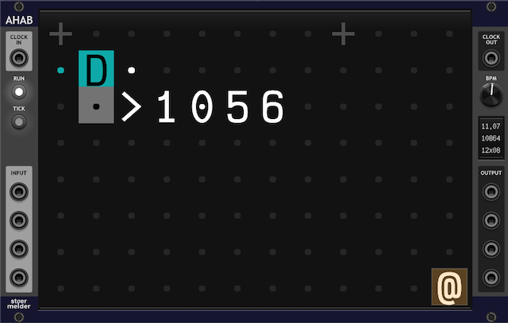
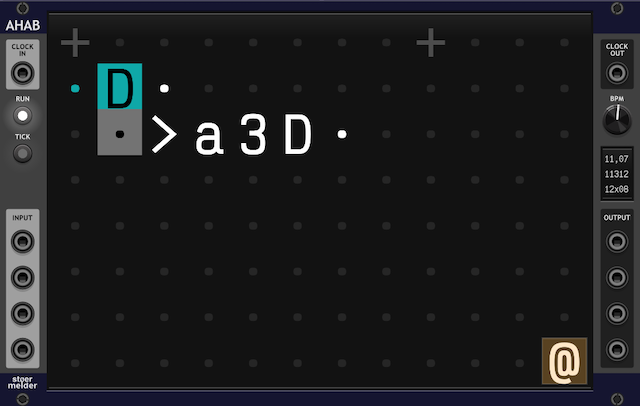

# stoermelder AHAB

AHAB is a port of the [ORCA-C](https://github.com/hundredrabbits/Orca-c) project into a VCV Rack module.

AHAB is a livecoding sequencer based on [ORCA](https://github.com/hundredrabbits/Orca). Create patterns and melodies by typing characters into a grid. Every letter is an operator with its own function — build sequences by chaining them together.



**Getting started**  

- Type characters in the field and build rhythmic or melodic patterns. Examples from the ORCA tutorial are embedded in the module and are available on the context menu - they are a great place to start. 
- The primary way to get musical data out of AHAB is via MIDI: AHAB can send MIDI to both one driver output and one of four virtual ports. The virtual ports must be enabled on the context menu before they can be used in other MIDI-capable modules. Use the operators `:` (MIDI note), `!` (MIDI CC) or `?` (MIDI pitchbend) to control synths and other modules.
- Use the Run button or the spacebar to start and stop the engine. 
- Please make sure to enable the option *Show tooltips* in VCV Rack's View menu - this will show a brief description of each operator when you hover over it.



**Resources**  

- https://metasyn.srht.site/learn-orca
- https://100r.co/media/content/projects/zine_orca.png
- https://100r.co/site/orca.html
- https://github.com/hundredrabbits/Orca

## CV operators `<` and `>`

AHAB provides two custom operators for reading/writing CV values. Both operators need a *bang* to update their output.

- **CV Read-operator `<`** — Use `<` to read values from the module's 4 input jacks.
  - `<1`, `<2`, `<3`, `<4` — Read numeric CV (0-10V mapped to 0-35)
  - `<a`, `<b`, `<c`, `<d` — Read pitch CV (V/Oct, outputs semitone mod 12)



This reads from input 1 and scales the value to a range of 0–5, which is mapped to the voltage range 0-10V. If input is 2V, the operator output will be 1.



This reads from input 1 (addressed as `a`) and outputs the note name for the corresponding V/Oct voltage. Octave and cents are ignored.

- **CV Write-operator `>`** — Use `>` to send values from the pattern to the module's 4 output jacks.
  - `>1`, `>2`, `>3`, `>4` — Write numeric CV (value in range 0-35 maps to 0-10V)
  - `>a`, `>b`, `>c`, `>d` — Write pitch CV (value is semitone, e.g., `>a3` outputs D3 in V/Oct)



This writes to output 1 and scales the value 5 to a range of 0-6, which is mapped to the voltage range 0-10V. In this case, output 1 will be 8.33V.



This writes to output 1 (addressed as `a`) a V/Oct pitch voltage of D3 (third octave D). The fourth  parameter (unused in the example) sets the length of the output signal - if this parameter is omitted, the voltage is held indefinitely. Otherwise the signal will go back to 0V after the number of ticks have been elapsed - this works similarly to the [MIDI operator `:`](https://metasyn.srht.site/learn-orca/#the-midi-operator).

## "pending bang" operator `+`

AHAB has a third custom operator `+`, which can be placed to create a manual *bang*. For technical reasons ORCA-C has no support for the *bang* operator `*`, and so does AHAB.


## Command operator `$`

The operator `$` runs a command from the grid, using the same command syntax as the [UDP input](#udp-input) (see *Supported commands* below). It needs a *bang*: the glyphs to its right up to the first `.` are the command, e.g. `$stop.` stops the simulation and `$write:Hi;0;5.` writes text into the grid. Commands run right after the step that triggered them.

## UDP input

AHAB can be controlled from the outside, like ORCA: when *UDP input* is enabled, every UDP datagram that arrives on the configured port is executed as a command. This allows other tools - another ORCA, Pure Data, controllers or live-coding scripts - to drive AHAB, even while the editor is closed.

The settings are found in the context menu under *UDP input*:

- **Enabled** — UDP input is off by default and stored with the patch.
- **Listen locally only** — enabled by default: AHAB only accepts datagrams from the same computer (`127.0.0.1`). Disable this to accept them from other computers in your network, too.
- **Port** — default is `49160`, the same as in ORCA. Confirm a new port with *Apply*.
- The last line shows the current status: *Listening* with the number of received and dropped datagrams, or the reason why the port could not be opened (e.g. *port in use*, when another AHAB or ORCA is already listening on it).

A command is a single datagram of the form `name:value`. Parts of a value are separated by `;`. Command names are case-insensitive and can be shortened to their first two letters (`fr:42`). Unknown commands are ignored and nothing is ever sent back to the sender. Datagrams longer than 256 bytes are dropped. A command ends at the first line break (`\n` or `\r`) or NUL character, and anything after it is ignored. AHAB executes at most one command per audio sample and in the order they arrive. Changes made by commands cannot be undone.

For example, using `nc` on macOS or Linux:

```
echo "frame:0" | nc -u -w0 127.0.0.1 49160
echo "write:HELLO;2;3" | nc -u -w0 127.0.0.1 49160
```

**Supported commands**

| Command | Description |
| --- | --- |
| `play` | Starts the simulation, like the Run button. |
| `stop` | Stops the simulation. |
| `run` | Executes a single step, like the Clock button. |
| `frame:N` | Sets the frame counter to `N`. |
| `skip:N` | Advances the frame counter by `N`. |
| `rewind:N` | Moves the frame counter back by `N`, but not below 0. |
| `write:text` / `write:text;x;y` | Writes `text` into the grid with its first character at column `x`, row `y` (both counted from 0 at the top left corner), or at the cursor if both are left out. Text running over the edge of the grid is cut off. Spaces are written as `.` (empty cells). Text with other non-printable characters is rejected, and it must not contain `;`. |
| `writes:text` | **AHAB only – not part of the original ORCA, other ORCA instances will not understand it.** Writes `text` into the current selection, starting at its top left corner. At the right edge of the selection the text continues in the next row at the selection's left edge; text longer than the selection is cut off. Spaces and other characters are handled as for `write`. |
| `select:x;y;w;h` | Moves the cursor to column `x`, row `y` and selects a block of `w` × `h` cells from there (both default to 1). The selection is kept inside the grid. |
| `find:text` | Selects the first occurrence of `text` in the grid, searching row by row from the top. Nothing happens if there is none. |
| `erase` | Clears the selection. |
| `copy` | Copies the selection into AHAB's own clipboard. The system clipboard is not used, so what you copied yourself is never overwritten by a remote command. There is no short form (`co` is ORCA's `color`). |
| `paste` / `pa` | Pastes AHAB's own clipboard at the cursor. |
| `cc:N` | Sets the offset (0-127) added to the control number of the MIDI CC operator `!`, like the *CC* options in the MIDI menu. |
| `pg:channel;bank;sub;program` | Sends a MIDI program change on `channel` (0-15), preceded by bank select MSB (`bank`, CC 0) and LSB (`sub`, CC 32). `bank`, `sub` and `program` are optional and left out if empty (`pg:3;;;12` sends only the program change). |
| `bpm:N` | Sets the tempo knob to `N` (30-300) and stops any running `apm` ramp. Has no effect on the tempo while the CLK input is patched. |
| `apm:N` | Ramps the tempo knob towards `N` (30-300) by 1 BPM per step of the internal clock. |
| `udp:out;in` | Sets the port (1-65535) of the *UDP* output (`out`) and of the UDP input (`in`); either can be left out. The input rebinds to the new port right away, so further commands must be sent there. |
| `osc:port` | Sets the port of the *OSC* output. |
| `ip:address` | Sets the address of both the *UDP* and the *OSC* output. |
| `time` | **Not supported.** ORCA command, ignored by AHAB. |
| `color` | **Not supported.** ORCA command, ignored by AHAB. |
| `inject:name;x;y` | **Not supported.** ORCA command for loading example files, ignored by AHAB. |

The same commands can be triggered from within the grid with the [operator `$`](#command-operator-).


## Random generator

Select a region of the grid and run the context menu command *Random generator* — AHAB composes a complete multi-voice arrangement in a shared key and groove, written as ordinary editable ORCA glyphs. See [**AHAB Generator**](./AhabGenerator.md) for how it works, what it produces and its limitations.

## Feature Comparison

AHAB has some features not found in the original ORCA/ORCA-C:

- The simulation can be triggered by an external clock signal, using the _Clock In_ port. This allows you to drive the simulation even by non-evenly spaced clock sources.

- A _Reset_ input allows you to reset the frame counter to zero, providing control over the simulation's timing from external sources.

- The copy/paste clipboard is shared across all AHAB instances in your Rack. You can copy/cut from one AHAB module and paste into another. You can save the content of the clipboard to a text file and save it as an ORCA file.

- Operators `<` and `>` let you read from and write to the module's CV ports.

- The usable MIDI CC range can be configured in the context menu, allowing you to use a range different from 64-99, as in ORCA-C.

- If tooltips are enabled in Rack's settings, hovering over operators will show a brief description and their input/output configuration.

Features missing in AHAB compared to ORCA:

- Hotkey Ctrl/Cmd+`P` to trigger the operator at the cursor is not available, as ORCA-C does not support this feature. AHAB has a special "pending bang" operator `+`, which will give you a similar result, when placing next to an operator.

Behavior that differs from ORCA-C:

- The operator `$` (commander) is available, although ORCA-C has no such operator. It works like in ORCA: when banged, the glyphs to its right up to the first `.` are executed as a command (e.g. `$frame:0.` or `$stop.`), using the same commands as the [UDP input](#udp-input). The command text is locked, so it is not interpreted as operators. Commands run right after the step that triggered them, in the order of the operators' positions; at most 8 commands are executed per step, further ones are dropped. The text is limited to 36 glyphs. Changes made by commands cannot be undone.

- The operator `=` (OSC) behaves like in ORCA, not like in ORCA-C. The glyph right of `=` is the path; the message is read from the glyphs after the path up to the first `.` and each glyph is sent as an integer (e.g. `=fBC.` sends `/f` with values 11 and 12). ORCA-C uses the second glyph as a length parameter instead and locks that many cells to the right, which disables any operators placed there.

### Keyboard Shortcuts

| Shortcut | Action |
|---|---|
| Space | Toggle run/stop |
| Backspace | Clear selected cells |
| Ctrl/Cmd + `Z` | Undo |
| Ctrl/Cmd + Shift + `Z` | Redo |
| Ctrl/Cmd + `N` | Clear entire field |
| Ctrl/Cmd + `O` | Load file |
| Ctrl/Cmd + `B` | Inject file at cursor |
| Ctrl/Cmd + `I` | Toggle insert mode (cursor moves right after typing) |
| Ctrl/Cmd + `A` | Select all |
| Ctrl/Cmd + `C` | Copy selected cells to clipboard |
| Ctrl/Cmd + `X` | Cut selected cells to clipboard |
| Ctrl/Cmd + `V` | Paste clipboard at cursor |
| Ctrl/Cmd + `F` | Run simulation for one frame |
| Ctrl/Cmd + Shift + `7` | Toggle comment block around selection |
| Ctrl/Cmd + Shift + `R` | Reset frame counter to zero |
| Arrow keys | Move cursor and selection |
| Shift + Arrow keys | Expand selection |
| Alt + Arrow keys | Move selected cells |
| Ctrl/Cmd + Arrow keys | Move by grid step (rows/cols) |
| Escape | Collapse selection to cursor |
| Shift + Escape | Toggle focus mode |
| `{`, `}` | Decrease/increase grid step rows |
| `[`, `]` | Decrease/increase grid step columns |

#### Customizing shortcuts

Most of the shortcuts above can be changed in `<Rack user folder>/Stoermelder-P1/keymaps/Ahab.jsonc`. The file is created the first time AHAB is used and can be edited with any text editor; Rack has to be restarted afterwards. It is a JSON file which additionally allows `//` comments, and every entry is preceded by a comment describing the action:

```jsonc
{
  "slug": "Ahab",
  "version": 1,
  "bindings": {
    // Undo (Edit)
    "edit.undo": "Ctrl+Z",

    // Toggle insert mode (Edit)
    "edit.insert.toggle": "Ctrl+I"
  }
}
```

- A shortcut is written as modifiers and a key joined by `+`, e.g. `Ctrl+Shift+K`. Modifiers are `Ctrl`, `Shift` and `Alt`; on Mac `Ctrl` stands for the `Cmd` key. Use an array to assign several shortcuts to one action, and `null` to remove all shortcuts of an action.
- The cursor movement is split into one action per direction and modifier combination, e.g. `nav.up`, `nav.up.gridstep`, `nav.up.extend` or `nav.up.move.extend.gridstep`.
- The descriptive comments are rewritten whenever AHAB saves the file, comments of your own are not kept.
- Shortcuts added by a new version of AHAB are added with their default to your existing file, the shortcuts you have changed are kept.
- If the file cannot be read (e.g. a typo in the JSON), the default shortcuts are used and the file is not overwritten, so you can fix it.
- Typing glyphs into the grid and the grid step keys (`{`, `}`, `[`, `]`) cannot be customized.

## Changelog

- v2.3.0
    - Initial release of AHAB
- v2.4.0
    - Added gate length as a parameter for operator `>` in note mode (#420)
    - Added reset input for tick counter (#429)
    - Added "pending bang" operator `+` (#427)
    - Fixed crash on operator `<` when using whithout maximum value set (#425)
- v2.6.0
    - Added undo for "Clear"
    - Added toggle for Focus mode using Shift+Esc
    - Added clock divider/multiplier for clock input
    - Added MIDI Panic option
    - Added context menu options for selections
    - Major enhacements for randomizer function
    - Fixed reset behavior on loading files or examples
    - Fixed broken MIDI channel on MIDI operators
    - Fixed concurrent usage of UDP and OSC output
    - Fixed various minor issues
- v2.7.0
    - Added fully customizable key-mapping (\<user-folder\>/Stoermelder-P1/keymaps/Ahab.jsonc)
    - Added reusable tiny Snippets to the context menu
- v2.x.x
    - Added UDP input to control AHAB with ORCA-style commands (`play`, `stop`, `run`, `frame`, `skip`, `rewind`, `write`, `writes`, `cc`, `pg`, `bpm`, `apm`, `select`, `find`, `erase`, `copy`, `paste`, `udp`, `osc`, `ip`)
    - Added operator `$` to run commands from the grid
    - Changed operator `=` (OSC) to read its message up to the first `.`
    - Undo and redo now restore the cursor and selection
    - Added support for "Light" ui theme 