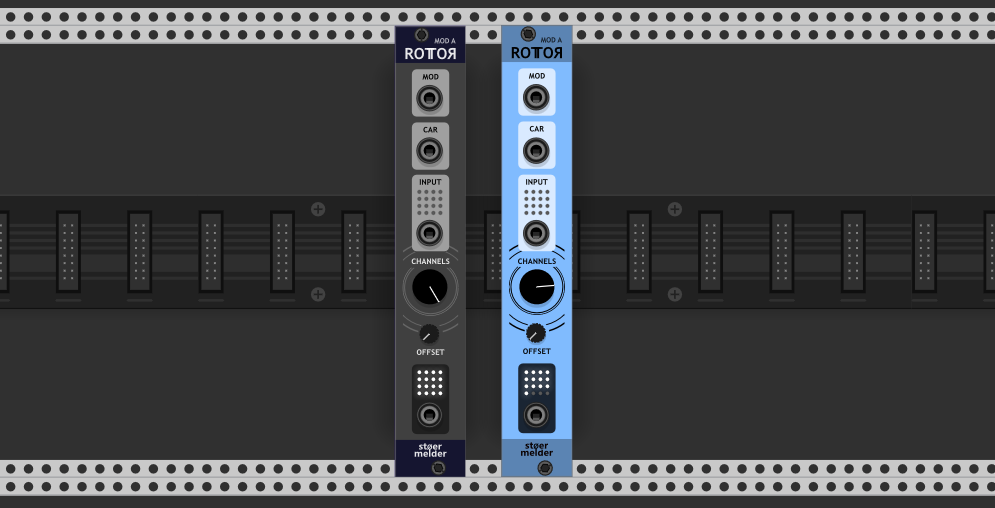
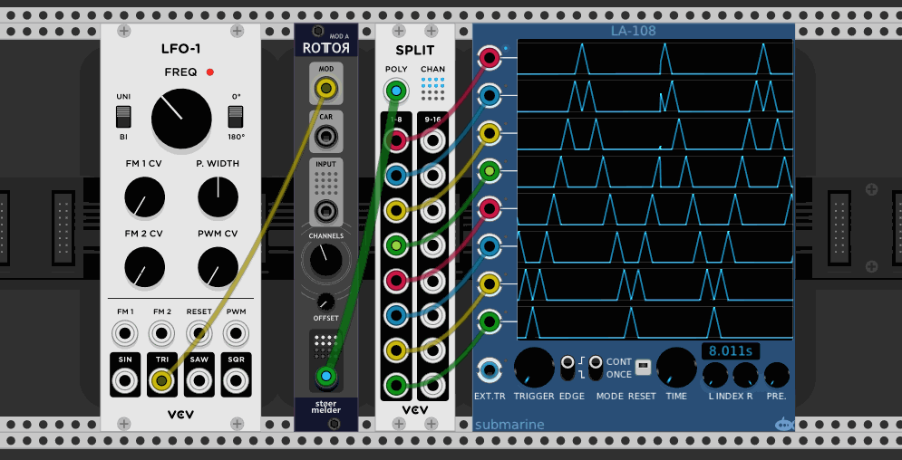
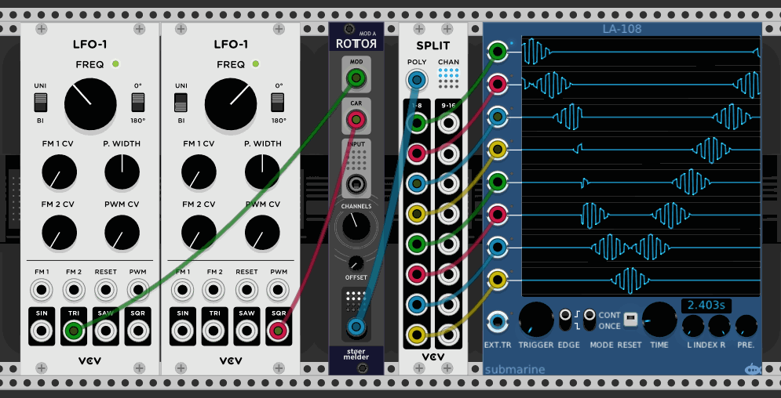
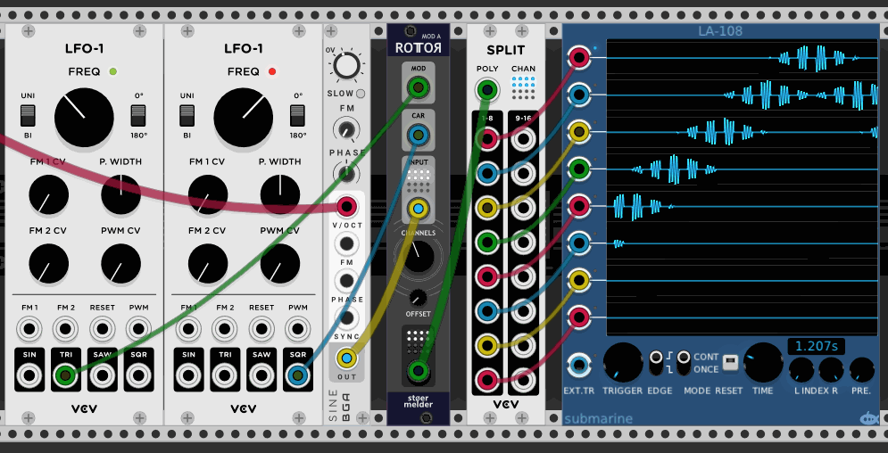

<!-- manual:exclude -->
# stoermelder ROTOR model A
<!-- /manual:exclude -->

ROTOR Model A is a modulator that distributes a carrier signal across up to 16 output channels.

<!-- manual:exclude -->

<!-- /manual:exclude -->

### Modulator

The _MOD_-input (modulator) is mandatory and defines how the carrier signal is modulated across the output channels. It has to be unipolar (0V..10V) and monophonic. When the channel knob is set to 4, an input voltage in the range 0V..2.5V (=10V / 4 channels) outputs the carrier on channel 1 with linear attenuation proportionally to the voltage between 0V and 2.5V. So, 0V outputs 100% of the carrier, 1.25V outputs 50% of the carrier and 2.5V (and above) 0%. Also, an input voltage of 1.25V outputs 50% of the carrier on channel 2.

<!-- manual:exclude -->

<!-- /manual:exclude -->

### Carrier

The _CAR_-input (carrier) is optional and monophonic. When no cable is connected a constant voltage of 10V is assumed. The carrier signal is spread accross the channels according to the voltage of the modulator.

<!-- manual:exclude -->

<!-- /manual:exclude -->

### Input

The _INPUT_-port is optional and should be polyphonic. An input signal on channel _x_ will be sent to the output on channel _x_ attenuverted using the carrier signal on channel _x_. An unconnected channel will be ignored.

<!-- manual:exclude -->

<!-- /manual:exclude -->

### _OUTPUT_-port

The **Channels** knob controls the number of active output channels (up to 16).

<!-- manual:exclude -->
## Changelog

ROTOR model A was introduced in v1.0 of PackOne.

<!-- /manual:exclude -->